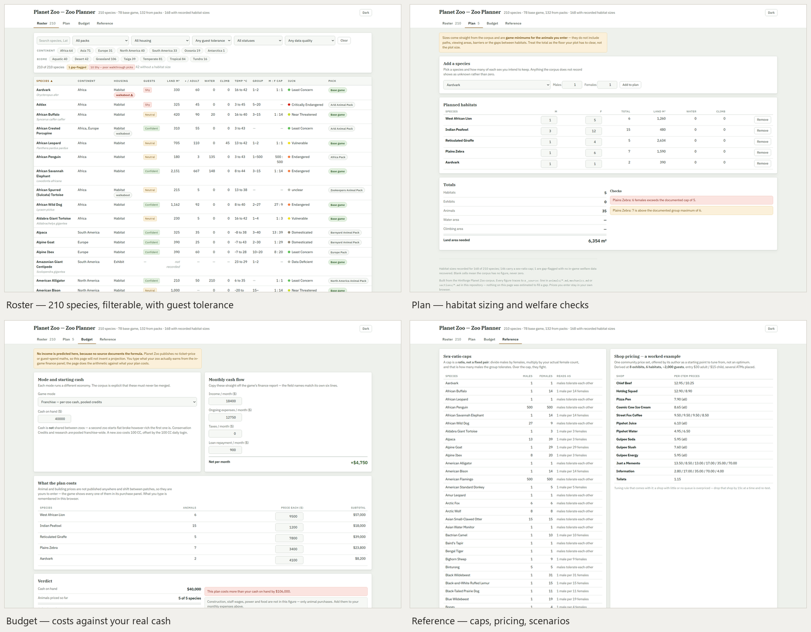

# Planet Zoo

A free hint guide for Planet Zoo, with spoiler settings you control. Get help with Frontier's wildlife management sim, from habitats and breeding to career scenarios and sandbox. Your AI agent answers only from the guide files.

## Use it

Install the [reader](https://github.com/hintforge/reader) in any AI agent that can read files on your computer, then tell it:

> Load the Planet Zoo guide from github.com/hintforge/planet-zoo

Ask about habitat needs, breeding or career goals. The guide uses the [Hintforge](https://github.com/hintforge/builder) format. The agent reads and writes only files you control.

## Spoilers

Enemy warnings (Tier 0 to 5) and puzzle or decision warnings (Tier 0 to 3) start silent. They rarely matter in sandbox; career objectives and outcomes follow the puzzle dial. There is no save reader.

## What's inside

- Welfare, conservation, economics, breeding, staff and guests.
- Habitat and welfare needs for 210 species across the base game and 21 DLC packs.
- Career scenarios, controls, settings and achievements.

## Zoo planner

Open [`artifacts/zoo_planner.html`](artifacts/zoo_planner.html) in any browser. Nothing is installed or leaves your machine.

- Roster: sort and filter species by space, temperature, group size, sex ratio, biome, diet, mixing, guest tolerance, conservation status and pack. Ten of 31 walkabout species are Shy; a filter shortlists guest-tolerant animals.
- Plan: total habitat area and flag sex-ratio or group-size problems.
- Budget: keep four economies separate, using your finance report. It cannot predict income; ticket-price and guest-spend formulas are unavailable.
- Reference: sex-ratio caps, shop pricing, opening advice and career medal objectives.

All 168 habitat species have sizes recorded. Missing figures say "not recorded", never zero. Rebuild with `python build.py` in [`artifacts/`](artifacts/).
